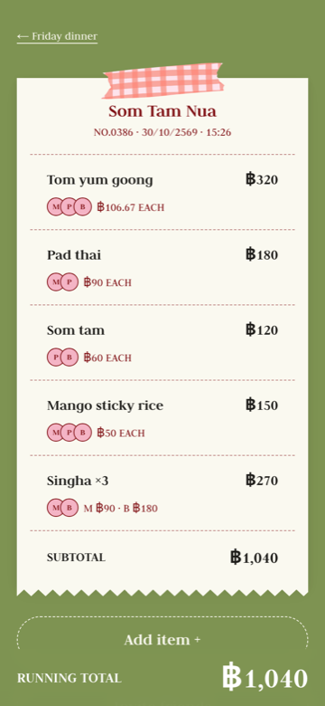
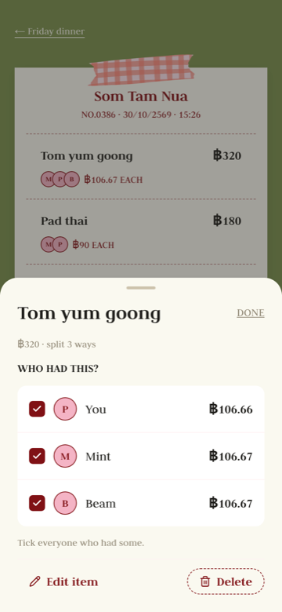
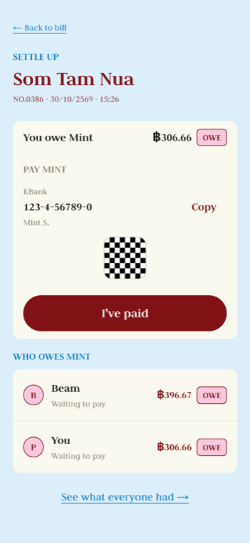
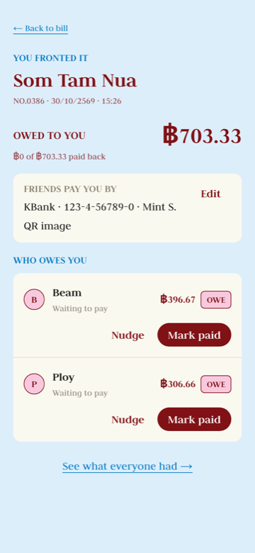
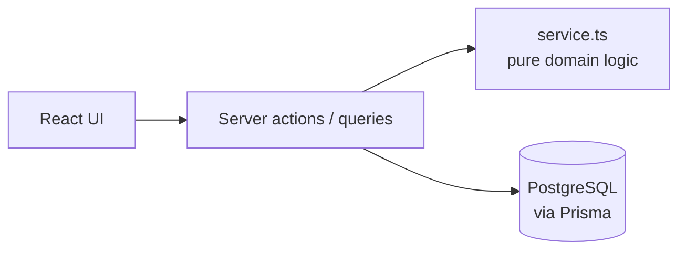

# Splitsy

_Split the bill, keep the vibe._

Splitsy splits a group dinner by what each person actually had. Add the dishes, tick
who shared each one, and everyone sees their exact share. The person who paid shares
a bank account or their bank app's QR, then nudges friends and marks them paid.

**Live:** [splitsy-pi.vercel.app](https://splitsy-pi.vercel.app) (sign in with Google)

<table>
  <tr>
    <td></td>
    <td></td>
    <td></td>
    <td></td>
  </tr>
  <tr>
    <td align="center">The bill</td>
    <td align="center">Who had this?</td>
    <td align="center">Pay back</td>
    <td align="center">Payer's view</td>
  </tr>
</table>

## What it does

- **Groups and invite links** — share a link; friends sign in with Google and join.
- **Itemized bills** — add dishes fast, tick who shared each one (anyone in the bill can
  tick for anyone), and fix or delete a dish while the bill is open.
- **Settle up** — the payer locks the bill; everyone sees exactly what they owe, with
  the payer's bank account to copy and their bank QR to scan.
- **Get paid back** — friends tap "I've paid"; the payer nudges and marks people paid
  until the bill is settled.

## Key decisions

**Money is integer satang, never floats.** `0.1 + 0.2 !== 0.3` in JavaScript, so every
amount is stored and computed in satang (฿1 = 100). Bills split with the
largest-remainder method: ฿100 ÷ 3 is ฿33.34 / ฿33.33 / ฿33.33, the parts always sum
to the bill, and ties go to a fixed order so the result never depends on input order.

**Changed the claiming rule after testing with real users.** I first built
self-report claiming — only you can tick your own dishes — so nobody could change what
someone else owes. Testing with friends on a real bill showed it was slow at the table,
and other people's disabled checkboxes read as a bug. Now anyone in the bill can tick
anyone in the bill; the server checks the person ticked is a member.

**Payment QRs are bank details, so access is checked on the server.** Only members of a
bill that the QR's owner paid for, once it's settling, can load it. "No QR" and "not
allowed" return the same 404 so ids can't be probed, and uploads are typed by their
bytes, not their name. Testing by hand, I found that signing out still showed the QR:
`Cache-Control: private, immutable` kept CDNs out but the browser cache isn't per user.
It's now `no-cache` with an ETag — re-authorised on every view, a bodiless 304 when
unchanged.

**Concurrency: lock, then let the first change win.** Settling up snapshots who owes
what under a PostgreSQL row lock (`FOR UPDATE`); item edits take a shared lock, so
nothing slips in mid-snapshot. Ticks are idempotent "set" operations, not toggles, so two
people ticking the same friend can't cancel out. If someone deletes a dish you're
editing, saving says so instead of failing silently.

**One backend, inside Next.js.** Server actions handle mutations (validate with zod →
check access → domain logic → Prisma); a route handler serves images. The money math is
pure functions in each module's `service.ts`, tested on their own and ready to be shared
with a future mobile API.



## Stack

- **Web:** Next.js 16 (App Router), React 19, TypeScript, Tailwind CSS v4, shadcn/ui
- **Design system:** `@splitsy/design-system` — TypeScript tokens generate the Tailwind theme
- **Backend:** Next.js server actions and route handlers, zod
- **Data:** PostgreSQL (Neon) with Prisma
- **Auth:** Clerk (Google)
- **Tests:** Vitest (unit + DB), Playwright (E2E)
- **Monorepo & deploy:** pnpm + Turborepo, Vercel — see [docs/DEPLOY.md](docs/DEPLOY.md)

## How it was built

Designed in Figma, then built step by step from [ROADMAP.md](ROADMAP.md) with an
AI-assisted workflow (Claude Code): plan each step, implement, commit, run a code review,
then fix what it finds before moving on. Every change runs through the test suites below.

## Getting started

```bash
corepack enable pnpm      # once, if pnpm isn't on PATH
pnpm install
pnpm dev                  # runs the web app on http://localhost:3000
```

`pnpm dev` uses the Neon dev database from `apps/web/.env` (copy `.env.example`). In
development you can sign in as a seeded friend ("Continue as Mint") without Google.

## Running tests

Unit tests need nothing else. DB and end-to-end tests run against a **local Postgres 17
in Docker** (`docker-compose.yml`), never Neon — they refuse to start otherwise. Start
Docker Desktop, then from `apps/web`:

```bash
pnpm test                 # unit tests (pure logic)
pnpm test:db:up           # start the test Postgres, migrate and seed it
pnpm test:db              # DB integration tests
pnpm test:e2e             # Playwright, on its own dev server (port 3100)
pnpm test:db:down         # stop the test Postgres (its data is in memory)
```

The e2e server builds into `.next-e2e`, so it runs alongside `pnpm dev`.

## Layout

```
splitsy/
├── apps/
│   └── web/                  # Next.js 16 app
│       ├── prisma/           # schema, migrations, seed
│       ├── e2e/              # Playwright tests
│       └── src/
│           ├── app/          # routes only — thin pages
│           ├── modules/      # bills, items, groups, settlement, auth
│           │                 #   actions.ts · queries.ts · service.ts · schema.ts · components/
│           ├── components/ui # shared primitives
│           └── server/       # db, auth, access rules, locks
├── packages/
│   └── design-system/        # design tokens → generated Tailwind theme
└── docs/                     # deploy notes, screenshots
```
